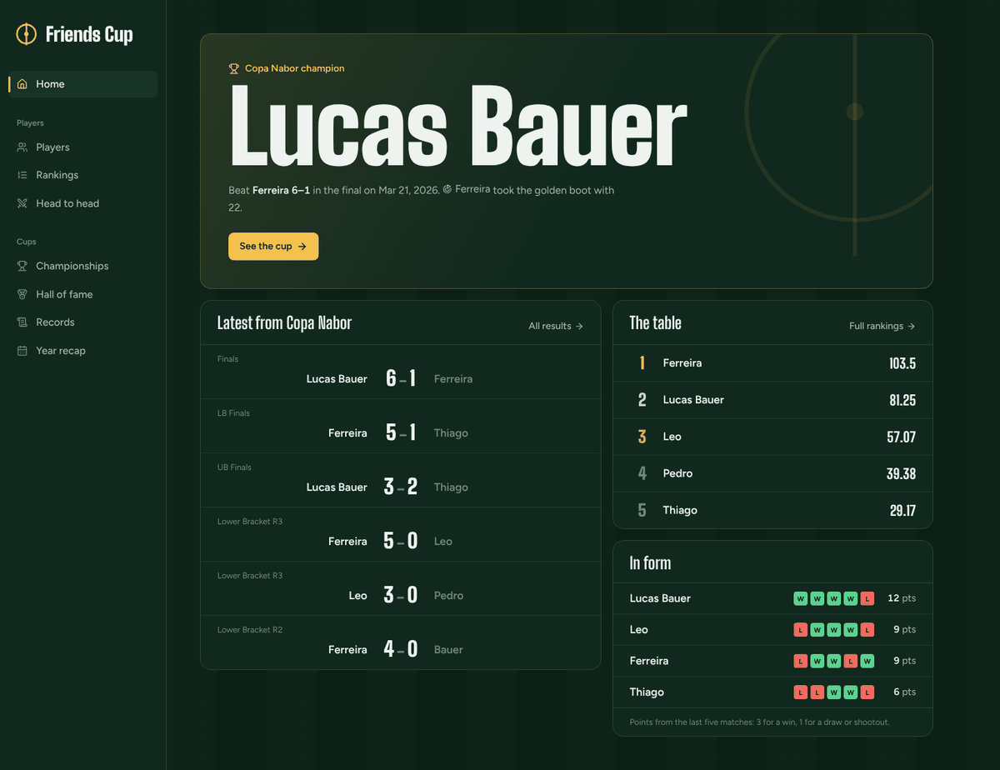
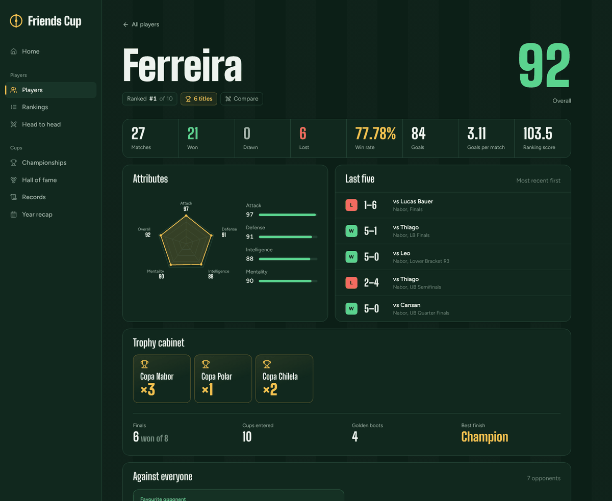
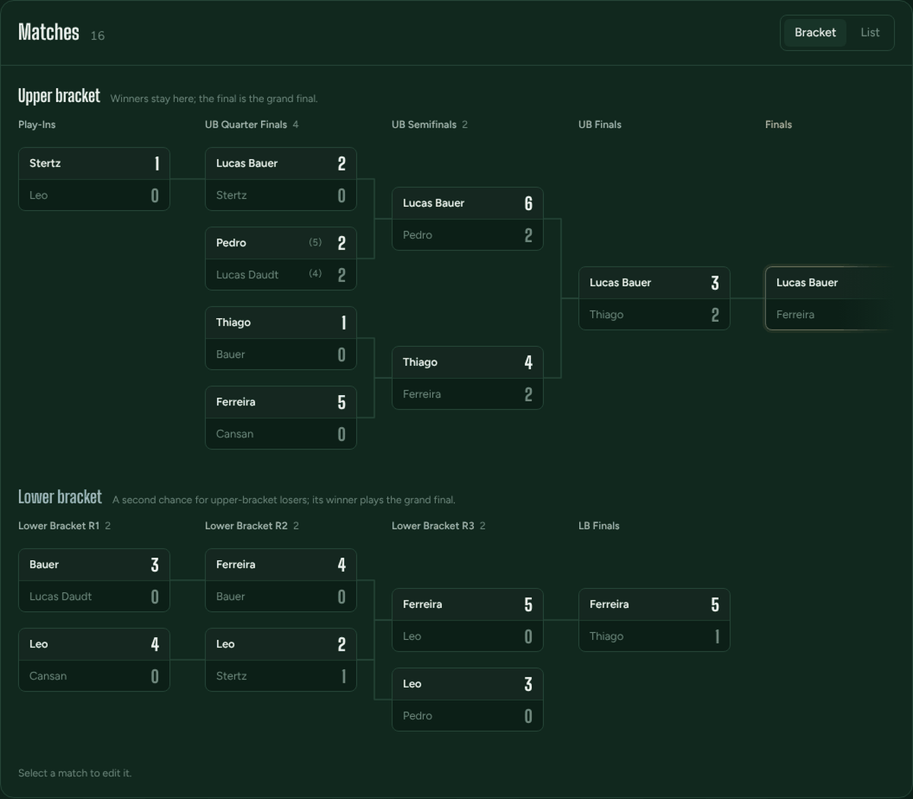
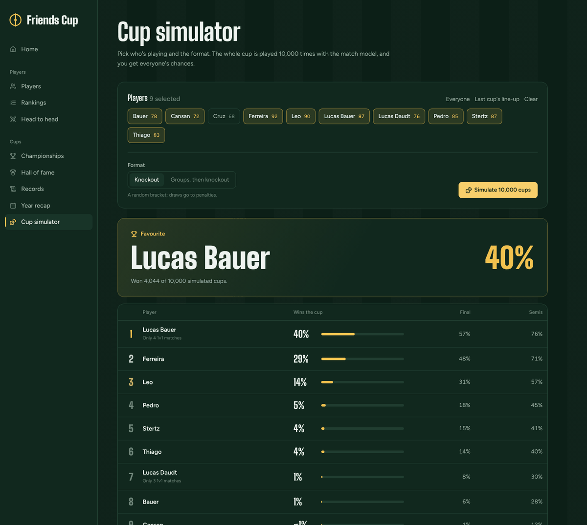

# 🏆 Friends Cup

**A full-stack app that records every match, title and rivalry from the football tournaments my friends and I have played over the years, and turns that history into rankings and stats.**


---



<table>
  <tr>
    <td></td>
    <td></td>
  </tr>
  <tr>
    <td align="center"><sub>Player page</sub></td>
    <td align="center"><sub>Double-elimination bracket</sub></td>
  </tr>
</table>



## What it does

- **Championships in any format**: group stages, knockouts, and double-elimination brackets (upper and lower bracket, play-ins, third-place match), in both 1v1 and 2v2 (duo) formats.
- **Weighted all-time ranking**: each player's score combines win rate, average goals and titles. Titles are weighted by cup prestige, so a "world cup" counts more than a state cup.
- **Head-to-head**: an H2H matrix between all players, the match-by-match history for any pair, and the top 10 rivalries.
- **Player pages**: career numbers, attribute radar, last five matches, trophy cabinet (finals record, golden boots, best finish), record against every opponent and a cup-by-cup history.
- **Fix mistakes**: any recorded match can be edited or deleted; group tables and the champion are updated to match.
- **Match predictor**: a Poisson model of every 1v1 result estimates each player's attack and defence, then gives win/draw/loss odds, expected goals and the most likely scores for any pairing. Recent matches count more, thin records are pulled towards the average, and draw odds are calibrated to how rarely FIFA games end level.
- **Rating history**: every player's ratings are saved after each cup, so their page charts how their overall has moved, and each cup shows the biggest rise and fall. Ratings from the old 1–5 system are kept as given and converted to 0–100 for the chart.
- **Cup simulator**: pick the players and a format (knockout, or groups then knockout) and the cup is played 10,000 times to give everyone's chances of winning, reaching the final and the semis. Or play one cup and watch it unfold: group tables, every score including penalty shootouts, the bracket and the champion's road to the title. Each cup has a number and a link, so friends can open the exact same cup.
- **Records and yearly recap**: all-time records, a winners list, and an annual "recap" with podiums such as the golden boot (most goals) and best defense.

## Architecture

The backend follows a **clean / layered architecture** in NestJS:

```
src/
├── domain/            Entities, repository interfaces (injection tokens), domain constants
├── application/
│   ├── usecases/      One use case per operation (rankings, H2H, recap, ...) + DTO assemblers
│   └── dtos/          Request/response contracts validated with Zod (nestjs-zod)
├── infraestructure/   Prisma repositories and mappers (Prisma model → domain entity)
└── presentation/      REST controllers (/api/players, /api/championships, /api/matches)
```

Use cases depend only on the repository **interfaces** in `domain/`. The Prisma implementations are injected through NestJS DI tokens, so the persistence layer can be swapped or mocked without touching business rules.

The **frontend** (`frontend/`) is a React + Vite SPA using TanStack Query, React Router and Tailwind CSS. In production it compiles to `public/`, and NestJS serves it as static files, so the API and the UI ship as **one deployable**.

## API overview

All routes are prefixed with `/api`.

| Resource | Endpoints |
|---|---|
| Players | `GET /players`, `POST /players`, `POST /players/:id`, `DELETE /players/:id`, `GET /players/rankings`, `GET /players/:id/form`, `GET /players/:id/retrospect`, `GET /players/:id/summary`, `GET /players/:id/rating-history` |
| Championships | `GET /championships`, `POST /championships`, `GET /championships/:id`, `POST /championships/:id/matches`, `PUT /championships/:id/matches/:matchId`, `DELETE /championships/:id/matches/:matchId`, `POST /championships/simulations`, `POST /championships/simulations/single`, `GET /championships/:id/rating-changes`, `POST /championships/:id/rating-snapshots`, `POST /championships/:id/duos`, `GET /championships/records`, `GET /championships/winners`, `GET /championships/recap/:year` |
| Matches | `GET /matches/rivalries`, `GET /matches/history/:playerId/:opponentId`, `GET /matches/history/:playerId/:opponentId/details`, `GET /matches/predictions/:playerId/:opponentId`, `GET /matches/power-ratings` |

## Data model

`Player`, `Championship`, `ChampionshipGroup`, `GroupPlayer` (points and goal difference), `Match`, `MatchParticipant` (goals and penalty shootout goals), `Duo` and `PlayerRatingSnapshot` (a player's ratings after a cup). The full schema is in [`prisma/schema.prisma`](prisma/schema.prisma).

## Tech stack

| Layer | Tools |
|---|---|
| Backend | NestJS 10, TypeScript, Prisma 6, Zod, Luxon |
| Database | PostgreSQL 17 (Docker), Adminer |
| Frontend | React 18, Vite, TanStack Query, React Router, Tailwind CSS |
| Tooling | Docker Compose, ESLint, Prettier |

## Getting started

### Prerequisites

Docker Desktop, plus Node.js 22 if you want to run the frontend dev server.

### Run it

```bash
git clone https://github.com/Pedro05Souza/FriendsCup.git
cd FriendsCup
cp .env.template .env      # defaults work out of the box
docker-compose up          # starts PostgreSQL, the API (hot reload) and Adminer
npm run migrate:dev        # applies the Prisma migrations
npm run db:restore         # optional: loads the sample data from dumps/dump.sql
```

The API runs at `http://localhost:3000/api`, and Adminer at `http://localhost:8080`.

### Frontend

```bash
cd frontend
npm install
npm run dev                # http://localhost:5173, proxies /api to port 3000
npm run build              # outputs to ../public, served by NestJS at http://localhost:3000
```

### Useful scripts

| Command | Description |
|---|---|
| `npm run start:dev` | Backend with hot reload |
| `npm run lint` / `npm run type-check` | ESLint / TypeScript checks |
| `npm test` | Unit tests (Jest) |
| `npm run prisma:studio` | Prisma Studio (database GUI) |
| `npm run db:dump` | Saves a timestamped dump to `dumps/` |
| `npm run db:restore` | Restores `dumps/dump.sql` |

### Continuous integration

Every pull request runs [GitHub Actions](.github/workflows/ci.yml): the backend is type-checked, unit-tested and built, and the frontend is type-checked and built.

## Author

**Pedro Henrique Ferreira Souza**: [GitHub](https://github.com/Pedro05Souza) · [LinkedIn](https://www.linkedin.com/in/pedro-henrique-ferreira-souza)
